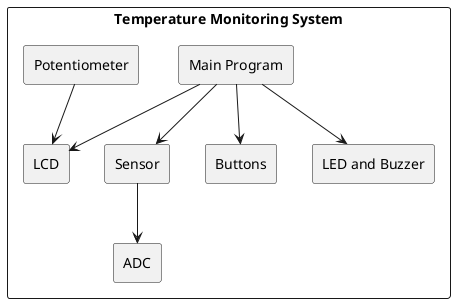
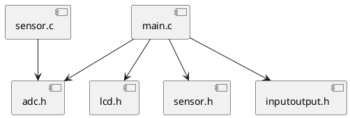

# Detailed Design Document

| **Group Members** |
|:------------------|
| Adam Hussien |
| Yehia Raffat |
| Yassin Fadel |

## Introduction

In this project, we made a temperature monitoring system using an Arduino UNO, an LM35 temperature sensor, and a 16x2 LCD.

The LM35 measures the temperature, and the Arduino reads the sensor value and shows the temperature on the LCD.

We used two push buttons to change the lower temperature limit (LL) and higher temperature limit (LH).

When the temperature goes below LL or above LH, the LED and buzzer turn ON, and the LCD shows NOK.

When the temperature is within the limits, the LED and buzzer stay OFF, and the LCD shows OK.

We also used a 10k potentiometer to adjust the LCD contrast so we can see the text clearly.

### Purpose

The purpose of this project is to make a simple system that measures temperature and warns the user when the temperature is too high or too low.

We wanted the user to be able to change the temperature limits using buttons instead of changing the code every time.

This project also helped us learn how to use the ADC, LCD, buttons, sensors, LED, and buzzer with C programming.

### Scope

The system uses an Arduino UNO, LM35 sensor, 16x2 LCD, two buttons, LED, buzzer, and 10k potentiometer.

The code is written in C using AVR registers.

## Architectural Overview

The project is divided into different parts. Each part has its own job.

### Assumptions & Constraints

- The Arduino UNO uses a 16 MHz clock.
- The LM35 is connected to A0.
- The ADC uses a 5V reference.
- The starting lower limit is 20°C.
- The starting higher limit is 35°C.
- The higher limit cannot go above 99°C.
- The lower limit must stay below the higher limit.
- The temperature reading is limited to 150°C.
- The 10k potentiometer controls the LCD contrast.

## Functional Description

When the Arduino starts, it sets up the LCD, ADC, buttons, LED, and buzzer.

The LM35 measures the temperature. The ADC reads the sensor value, and the program calculates the temperature.

The LCD shows the temperature, LL, LH, and OK or NOK.

The LL button increases the lower limit by 1°C.

The LH button increases the higher limit by 1°C.

If the temperature goes below LL or above LH, the LED and buzzer turn ON.

Otherwise, they stay OFF.

The potentiometer is used to adjust the LCD contrast.

## Implementation of the Module

The main program runs inside a while loop.

First, it checks if any button is pressed.

Then it reads the temperature from the LM35.

After that, it compares the temperature with the two limits.

Finally, it controls the LED and buzzer and updates the LCD.

The loop repeats every 100 milliseconds.

## Integration and Configuration

In this project, we used different code files to control the components.

All the files work together in the main program.

We connected the LM35, LCD, buttons, LED, buzzer, and potentiometer to the Arduino UNO.

### Static Files

| File Name | Contents |
|-----------|----------|
| main.c | Main program |
| adc.c | Reads analog values |
| adc.h | ADC functions |
| sensor.c | Calculates temperature |
| sensor.h | Sensor function |
| lcd.c | Controls the LCD |
| lcd.h | LCD functions |
| inputoutput.c | Controls buttons, LED and buzzer |
| inputoutput.h | Input and output functions |

### Include Structure

The main program uses the header files to access the different functions.

### Configuration

| Name | Value | Description |
|------|-------|-------------|
| F_CPU | 16000000UL | Arduino clock |
| LM35 | A0 | Temperature sensor |
| LL Button | D7 | Increase lower limit |
| LH Button | D6 | Increase higher limit |
| LED | D13 | Warning light |
| Buzzer | D10 | Warning sound |
| LCD RS | D12 | LCD register select |
| LCD Enable | D11 | LCD enable pin |
| LCD D4 | D5 | LCD data |
| LCD D5 | D4 | LCD data |
| LCD D6 | D3 | LCD data |
| LCD D7 | D2 | LCD data |
| Potentiometer | 10k ohm | Adjust LCD contrast |
| LCD VO | Potentiometer middle pin | LCD contrast control |
| Lower Limit | 20°C | Starting LL |
| Higher Limit | 35°C | Starting LH |
| Max Temperature | 150°C | Maximum calculated value |
